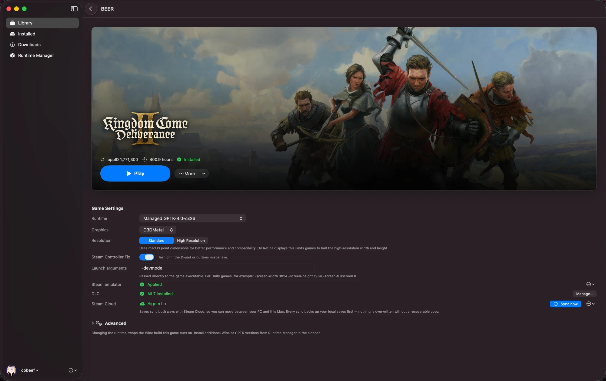
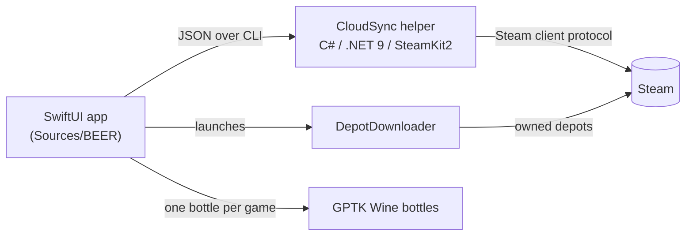

# BEER (Bottled Executable Environment Runner)

[](https://github.com/JarJarJames/BEER/actions/workflows/ci.yml)

BEER is a native macOS Steam library client for Apple Silicon. You sign in with
the Steam Mobile App. BEER downloads the games your account owns, gives each one
its own Wine bottle on Apple's Game Porting Toolkit, and syncs saves both ways
with Steam Cloud. I built it to play **Kingdom Come: Deliverance** and
**Kingdom Come: Deliverance II** on my MacBook and continue from the saves I left
on my Windows PC. Both games now run on my Mac with their saves synced.
Most of the work went into the parts that touch Steam: one Swift app driving
a small SteamKit2 helper over a JSON CLI, a save sync that backs up before
every write, and a logon strategy that stays clear of Steam's rate limits.



> **Apple Silicon (M1+) and macOS 14+.** Intel Macs aren't supported.

**Status:** I use it every day and maintain it myself. Issues and pull requests
get reviewed as time allows.

## Features

- **QR sign-in.** You approve the login in the Steam Mobile App. BEER never asks
  for a password and doesn't need a Steam Web API key.
- **Your library.** Owned games come from the account itself. Installed games
  sort to the top, and there's an Installed tab.
- **Per-game installs.** [DepotDownloader](https://github.com/SteamRE/DepotDownloader)
  downloads each game into its own Wine bottle, so runtimes and settings never
  collide between games.
- **Two-way Steam Cloud saves.** BEER pulls before you play and pushes after you
  quit, with a local backup before every write.
- **Steam presence, play time and achievements.** Friends see what you're playing,
  hours count on your profile, and achievements you unlock in-game are recorded
  on your account.
- **DLC.** Each game page shows the game's DLC and which ones the account owns,
  and installs the owned ones.
- **Per-game runtime control.** Choose GPTK or Wine runtimes, DXVK/DXMT
  translators, Standard or High Resolution display mode, a Windows version,
  launch arguments and environment variables for each game.
- **Controllers.** Wine gets the gamepads macOS reports. An optional per-game fix
  restores the D-pad and buttons on Steam Input's virtual pad.

## Architecture



There are two halves:

- **The Swift app** (`Sources/BEER/`) owns the UI, bottle management, installs,
  launches, and all sync decisions.
- **The CloudSync helper** (`Tools/CloudSync/`) is a small .NET program built on
  SteamKit2. It speaks the Steam *client* protocol for auth, owned games, DLC,
  presence, achievements and cloud file transfer. Each command prints one JSON
  result, and the Swift side decodes it into typed errors such as
  `.authExpired` and `.rateLimited`. Keeping the protocol work in its own
  process keeps the app's side of the boundary small and testable.

Each game gets its own Wine prefix under
`~/Library/Application Support/BEER/Bottles/`. Games are launched directly
through Wine, without a desktop wrapper. `HANDOFF.md` has the full map.

### Running games without the Steam client

The real Steam client doesn't run on GPTK. Its web helper crash-loops, and
`HANDOFF.md` §7 has the details. Most Steam games call the Steamworks API at
startup and quit if no client answers. So when BEER installs a game, it puts the
[GBE_Fork](https://github.com/Detanup01/gbe_fork) Steamworks implementation
(formerly Goldberg) in place of the game's `steam_api` DLLs, and that answers
those calls locally. Some limits on how BEER uses it:

- It is applied only to games your account owns, downloaded with your own
  sign-in. It doesn't unlock, crack or download anything.
- It reports your real SteamID and account name.
- It declares a DLC only when Steam says your account owns it. Ownership is
  checked the same way the Steam client checks it.
- The achievement list comes from Steam's schema for the game. In-game unlocks
  go to your real account through the helper.
- The original DLLs are kept next to the stubs as `.original`. **Restore
  original Steam DLLs** on the game page puts them back.

Games protected by anti-cheat, or that need Steam's multiplayer services,
aren't expected to work.

## Cloud Save Sync

Saves are the one thing BEER can't afford to get wrong, so the sync is
deliberately conservative:

1. **Pull before play, push after.** BEER syncs before it launches a game and
   again when the game exits.
2. **Back up before every write.** Before any pull or push, every tracked save
   file is copied to `CloudSaveBackups/<appid>/<timestamp>-*/`. No sync runs
   without that copy.
3. **Timestamps decide, SHA-1 confirms.** A file only overwrites the side that is
   strictly older. When timestamps differ but Steam's SHA-1 matches the local
   bytes, BEER skips the file, which avoids pointless transfers and false
   conflicts.
4. **Path mapping.** Steam's cloud paths (`%WinSavedGames%kingdomcome/saves/…`)
   map to the bottle's `drive_c/users/…`. For uploads, BEER copies the remote
   directory layout already used by the game's existing cloud files.

"Back up & clear local saves" also copies before it removes anything, and it
never touches the cloud. Each sync writes a readable
`CloudSaveBackups/<appid>/last-sync.log`.

### Two logons per sync

Early versions logged on once per file, and on a large save folder Steam's
connection managers started rate-limiting the account. Now a sync costs exactly
two logons. `enumerate` lists the cloud files, Swift computes the upload and
download sets, and one `batch` call moves everything over a shared HTTP client,
at most four files at a time, finishing downloads before uploads start. The
helper reports a rate limit separately from a revoked token, so BEER waits out
a throttle and doesn't send you back to the QR sheet, which would only make the
cooldown longer.

## Security

- **No passwords.** Sign-in is QR-only through the Steam Mobile App.
- **Tokens live in the Keychain.** The Steam refresh token is stored in the macOS
  Keychain. DepotDownloader needs its own credential file, so BEER writes a
  short-lived one for each download and deletes it when the process exits and
  again during crash recovery.
- **No Web API key.** Everything goes through the authenticated client protocol.
- **No shell interpolation.** External processes run with argument arrays.

To report a vulnerability, see [SECURITY.md](SECURITY.md).

## Testing

`swift test` runs an offline XCTest suite. It doesn't sign in and doesn't need a
Steam account. It mocks the boundary between the app and its helpers and covers:

- parsing CloudSync JSON and errors
- DepotDownloader output
- SHA-1 digests
- DLC and achievement config writes for the emulator, including restore
- achievement unlock detection
- bottle migration
- non-Steam games
- the dependency installer's manifest and detection

`dotnet test Tools/CloudSync.Tests` runs the helper's xUnit suite, also offline. It
covers argument parsing, how logon failures are classified (rate limit or
re-sign-in), unwrapping Steam's zipped cloud files, the achievement schema, and
the helper's exit codes and JSON errors.

CI runs both suites on every pull request, plus release builds and a C# style
check. Anything that touches account state gets an offline test alongside it.

## Known limitations

- GPTK runs games borderless and controls the window, so there's no macOS title
  bar or green fullscreen button.
- Anti-cheat and Steamworks multiplayer titles aren't supported.
- Adding a non-Steam game (a folder already on disk) is new and still rough.
- Builds are ad-hoc signed, not notarized (see Install).

## Install

Download `BEER.zip` from [Releases](https://github.com/JarJarJames/BEER/releases),
unzip it, and move `BEER.app` to `/Applications`. The build isn't notarized, so
run this once:

```bash
xattr -dr com.apple.quarantine /Applications/BEER.app
```

On first run, BEER installs DepotDownloader and walks you through QR sign-in.
The first time you install a game, it also downloads Apple's Game Porting
Toolkit runtime, which is large.

## Build from source

```bash
swift build                      # compile
swift run BEER                   # run
swift test                       # offline app tests
dotnet test Tools/CloudSync.Tests  # offline helper tests
scripts/build_app.sh 0.5.2       # → .build/BEER.app + .build/BEER.zip
```

`build_app.sh` compiles a release build, bundles the CloudSync helper, ad-hoc
signs the app and zips it. You need .NET 9 to build the helper.

## How it's built

I prototyped BEER with AI coding tools. I designed the architecture and reviewed
and hardened the code, and I maintain it. The rules that keep it consistent are
written down: `PROJECT_STRUCTURE.md` for layout, `CONVENTIONS.md` and `AGENTS.md`
for contributors and tooling, and the offline test suite for checking changes.

## Contributing

Pull requests are welcome. Start with `CONTRIBUTING.md`. In short: Apple Silicon
and macOS 14+ only, test only against your **own** Steam account, and nothing
touches saves without a backup.

- `HANDOFF.md` covers architecture, debugging entry points and known sharp edges.
- `CONVENTIONS.md` covers coding conventions and what "done" means for a PR.
- `GOVERNANCE.md` covers how changes land.
- `Tools/CloudSync/README.md` covers the SteamKit2 helper.

## Legal

- **Unofficial.** BEER is an independent project. It isn't affiliated with,
  endorsed by or sponsored by Valve, Steam, Apple, or the GameNative Android
  project that inspired it. Trademarks belong to their owners and are used only
  to describe interoperability.
- **Your own account and games.** BEER signs in with your account, downloads
  only what that account owns, and syncs through Steam Cloud. Valve doesn't
  support third-party clients, so use of one is at your own discretion.
- **No warranty.** BEER is provided as is under the MIT license. It modifies game
  files and save data, and despite its automatic backups, the authors aren't
  liable for lost data.

Rights holders with a concern can open an issue, or use **Security → Report a
vulnerability** for a private channel.

## License

[MIT](LICENSE), © Saint Widukind Technologies LLC. DepotDownloader, GBE_Fork and
Apple's Game Porting Toolkit are downloaded by the app at runtime and keep their
own licenses. None of them are redistributed in this repository.
